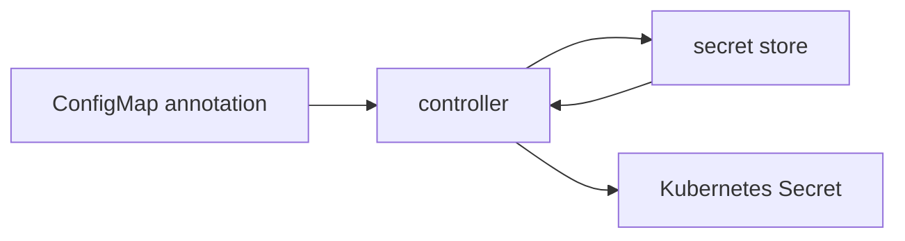

# ConfigMap-to-Secret sync controller

Apps often need secrets from a cloud secret store. Copying those values into Kubernetes by
hand means they end up pasted into terminals and chat logs, which leaks them. And once
copied, a manual Secret goes stale the moment the value rotates in the store.

This controller watches ConfigMaps for a sync annotation and keeps a matching Secret in
step with the named entry in the secret store.

## Flow



## RBAC

Minimum permissions the controller needs in its namespace:

```yaml
apiVersion: rbac.authorization.k8s.io/v1
kind: Role
metadata:
  name: secret-sync-controller
rules:
  - apiGroups: [""]
    resources: ["configmaps"]
    verbs: ["get", "list", "watch"]
  - apiGroups: [""]
    resources: ["secrets"]
    verbs: ["get", "create", "update"]
```

## Status

Tested with unittest and fakes only. Not run against a cluster or AWS.

## Known limitations

- Not run against a real cluster or AWS.
- Secret values are never logged.
- Only one namespace is watched.
- Rotation is handled by the poll, not by a push from the store.
